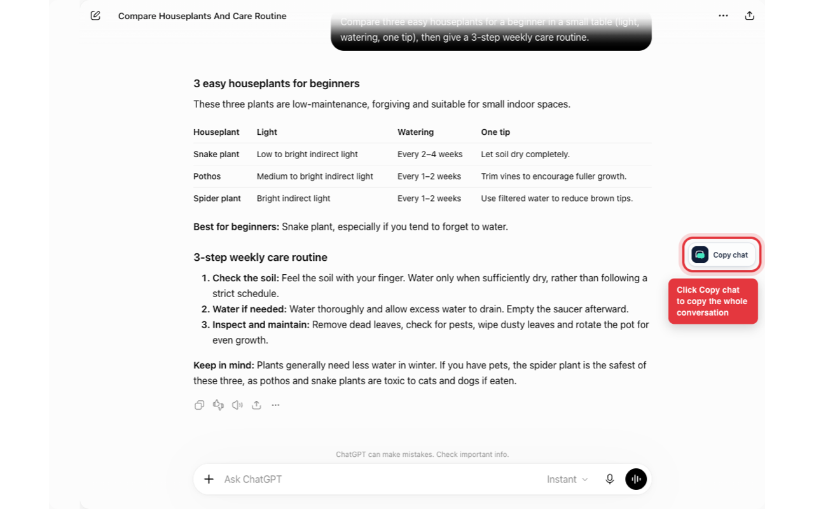
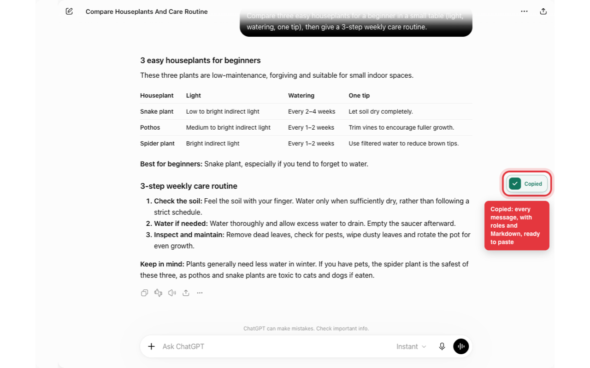

<p align="center"></p>

# ChatCopy

Copy a whole AI chat conversation in one click, with roles and formatting kept. Everything is processed locally in your browser.

English | [简体中文](README.zh-CN.md)

## Install

**[Install from the Chrome Web Store](https://chromewebstore.google.com/detail/agefjnchhjcoielgfcoafddcfmkgbdgk)** — recommended, free, and it updates automatically. Or download the ZIP from [Releases](https://github.com/duffercn/chatcopy/releases/latest) and follow [Manual install (ZIP)](#manual-install-zip).



*Click Copy chat.*



*The whole conversation is copied, ready to paste.*

## Supported sites

- ChatGPT — chatgpt.com
- Claude — claude.ai
- Gemini — gemini.google.com
- Grok — grok.com
- DeepSeek — chat.deepseek.com
- Doubao (豆包) — doubao.com

## How to use

1. Sign in to the site as usual.
2. Open a saved conversation.
3. Click the floating **Copy chat** button at the bottom right of the page, or click the toolbar icon and choose **Copy current conversation**, or press `Ctrl+Shift+C` (`Command+Shift+C` on macOS).
4. Paste wherever you need the transcript.

## Why not just select all?

Long conversations only load the messages near the screen, so select-all misses most of the chat — in our tests on long ChatGPT and Claude chats it captured under 10% of the text. What it does capture loses who said what, and arrives without code blocks or tables.

## What you get

- Every message, in order, labelled by role.
- Markdown kept as written: headings, lists, tables, fenced code blocks, links.
- Cited sources as links you can follow.
- Images, files and attachments marked, never silently dropped.
- Hidden reasoning, notices and suggested follow-ups left out.

## Privacy

Your conversation is processed locally in your browser. It is not uploaded to the developer, there is no analytics, and no history is stored — nothing is kept after the copy. [Privacy policy](privacy-policy.md)

## Manual install (ZIP)

1. Download `chatcopy-0.7.1.zip` from the [latest Release](https://github.com/duffercn/chatcopy/releases/latest).
2. Unzip it. You get a folder with `manifest.json` inside.
3. Open `chrome://extensions`.
4. Turn on **Developer mode** (top right).
5. Click **Load unpacked** and pick the unzipped folder.
6. Pin the extension so the toolbar icon stays visible.

Manual installs do not auto-update. To update, download the new ZIP and repeat these steps, or install from the Chrome Web Store.

## Known limits

- You must be signed in, and the conversation must be saved.
- A site change can break copying until an update is released.
- Some very long or branched conversations are refused with an error rather than copied partially.

## For developers

Requires Node.js 20 or newer.

```sh
npm install
npm test        # automated tests for each site's conversion logic
npm run build   # writes the loadable extension to dist/
npm run package # builds and zips dist/ into release/
```

Site adapters live in `src/platforms/`.
