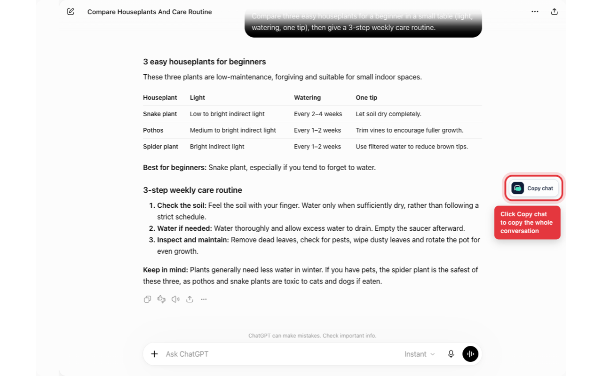
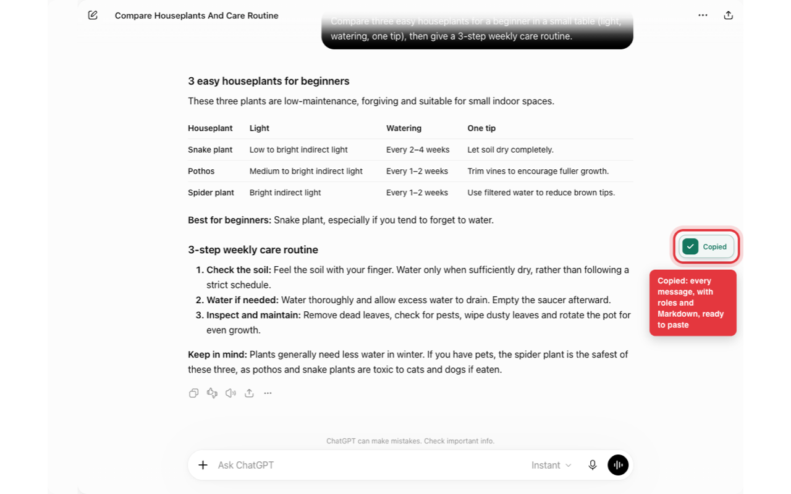

<p align="center"></p>

# ChatCopy

一键复制整段 AI 聊天对话，角色和格式都完整保留。所有处理都在你的浏览器本地完成。

[English](README.md) | 简体中文

## 安装

**推荐[从 Chrome 应用商店安装](https://chromewebstore.google.com/detail/agefjnchhjcoielgfcoafddcfmkgbdgk)**，免费，并且会自动更新。也可以从 [Releases](https://github.com/duffercn/chatcopy/releases/latest) 下载 ZIP，然后按[手动安装（ZIP）](#手动安装zip)操作。



*点击 Copy chat（复制当前对话）。*



*整段对话都已被复制，可以直接粘贴。*

## 支持的网站

- ChatGPT — chatgpt.com
- Claude — claude.ai
- Gemini — gemini.google.com
- Grok — grok.com
- DeepSeek — chat.deepseek.com
- 豆包（Doubao）— doubao.com

## 使用方法

1. 像平时一样登录网站。
2. 打开一个已保存的对话。
3. 点击页面右下角浮动的 **Copy chat**（复制本对话）按钮，或点击工具栏图标后选择 **Copy current conversation**（复制当前对话），也可以按 `Ctrl+Shift+C`（macOS 上为 `Command+Shift+C`）。
4. 粘贴到你需要的任何地方。

## 为什么不直接用全选复制？

长对话只会加载屏幕附近的消息，所以全选会漏掉大部分内容——在我们对 ChatGPT 和 Claude 长对话的测试中，全选只拿到不到 10% 的文本。即便拿到的那一小部分，也丢失了谁说了什么，并且没有代码块和表格。

## 复制结果包含什么

- 每条消息都按顺序保留，并标明角色。
- Markdown 按原样保留：标题、列表、表格、代码块、链接。
- 引用来源变成可点击的链接。
- 图片、文件和附件会被标注出来，不会悄悄丢掉。
- 隐藏的推理过程、提示和推荐追问不会写入。

## 隐私

对话在你的浏览器本地处理，不会上传给开发者，没有统计埋点，也不会保存任何历史——复制完成后什么都不留。[隐私政策](privacy-policy.md)

## 手动安装（ZIP）

1. 从[最新 Release](https://github.com/duffercn/chatcopy/releases/latest) 下载 `chatcopy-0.7.1.zip`。
2. 解压，得到一个包含 `manifest.json` 的文件夹。
3. 打开 `chrome://extensions`。
4. 打开右上角的 **Developer mode**（开发者模式）。
5. 点击 **Load unpacked**（加载已解压的扩展程序），选择解压出来的文件夹。
6. 把扩展固定到工具栏，图标就会一直可见。

手动安装不会自动更新。需要更新时，下载新的 ZIP 再重复上述步骤，或者改用 Chrome 应用商店安装。

## 已知限制

- 必须已登录，且对话必须是已保存的。
- 网站改版后，可能需要等待扩展更新才能恢复复制。
- 部分超长或带分支的对话会直接报错，而不是只复制一部分。

## 开发者说明

需要 Node.js 20 或更高版本。

```sh
npm install
npm test        # 运行自动化测试，检查各网站的转换逻辑
npm run build   # 生成可直接加载的扩展到 dist/
npm run package # 打包 dist/ 并生成 release/ 下的 ZIP
```

各网站适配器位于 `src/platforms/`。
